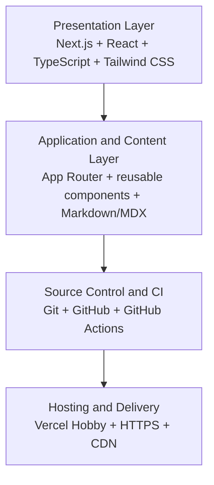
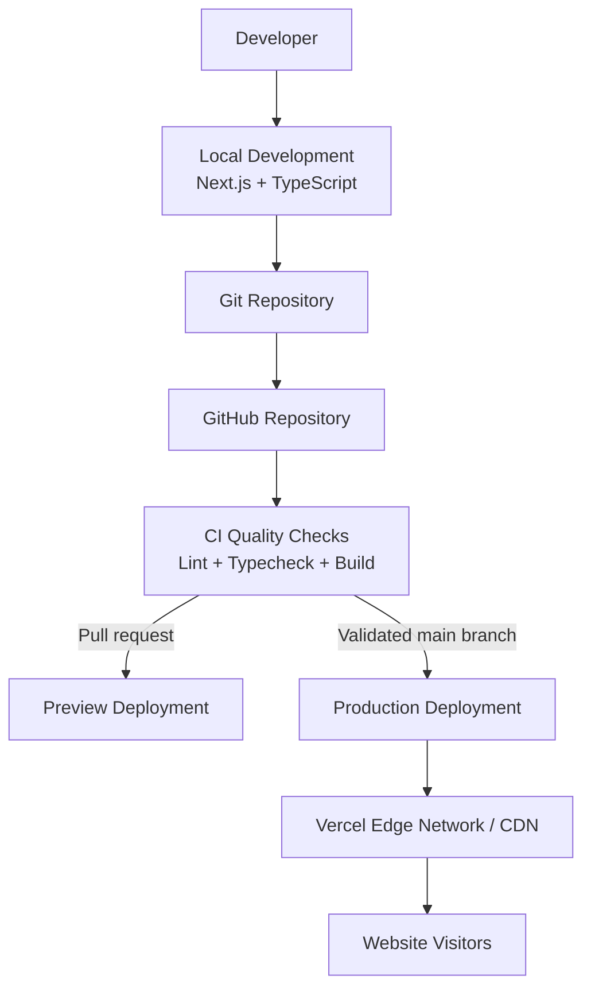
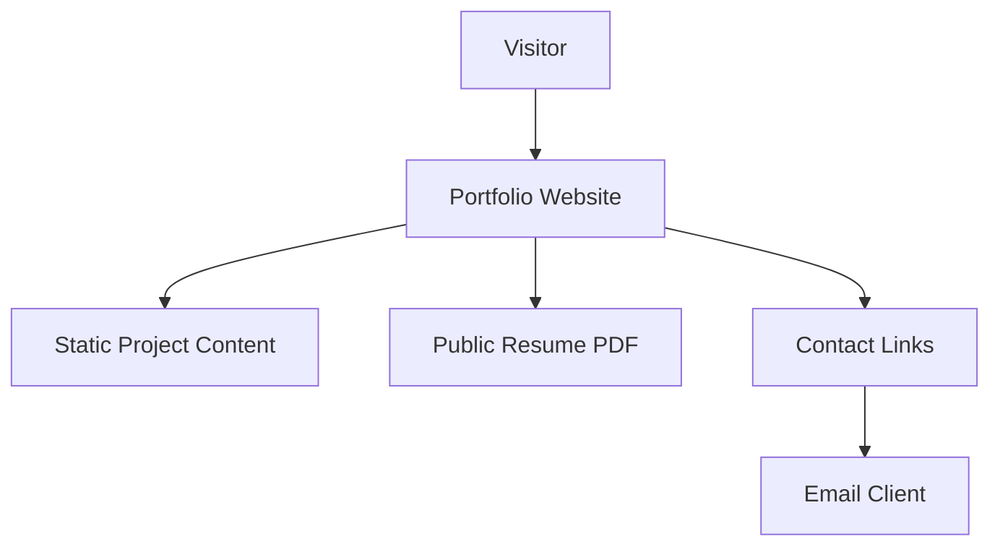

# Developer Portfolio: Full Architecture and Free Deployment Plan

## Objective

Build a production-minded, recruiter-focused developer portfolio using **Next.js, TypeScript, Tailwind CSS, GitHub, and Vercel**.

The goal is to create a portfolio that demonstrates your abilities as an AI-integrated software developer—not merely a website containing your name, skills, and résumé.

The architecture should be professional enough to extend later, but simple enough to build, maintain, and deploy for **৳0 initially**.

## 1. Recommended Architecture



### Presentation layer

- Responsive website and navigation
- Project cards and case studies
- Résumé and contact links
- Accessible, recruiter-friendly layouts

**Recommended technologies:** Next.js, React, TypeScript, and Tailwind CSS.

### Application and content layer

- Reusable components
- Project metadata
- Markdown/MDX case studies
- SEO configuration and utility functions

**Recommended technologies:** Next.js App Router and local content files.

### Source control and continuous integration

- Version history
- Linting and type checking
- Build verification
- Preview deployments and production releases

**Recommended technologies:** Git, GitHub, and GitHub Actions.

### Hosting and delivery

- Automated builds
- HTTPS
- CDN delivery
- Production deployments and rollback through deployment history

**Recommended platform:** Vercel Hobby with a free `vercel.app` subdomain, subject to its current plan limits and terms.

The important architectural decision is to make the portfolio **mostly statically rendered**. Pages and project descriptions do not need a database or a continuously running server. Next.js can generate pages at build time, while the hosting platform delivers the finished site.

Reference: [Next.js static exports](https://nextjs.org/docs/app/guides/static-exports)

## 2. Technology Stack

| Layer | Recommended technology | Purpose |
|---|---|---|
| Framework | Next.js App Router | Pages, routing, and rendering |
| Language | TypeScript | Type safety and maintainability |
| UI | React | Reusable interface components |
| Styling | Tailwind CSS | Responsive layouts and consistent design |
| Icons | Lucide React | Consistent, lightweight iconography |
| Content | Markdown/MDX + TypeScript data | Projects, case studies, and articles |
| Source control | Git + GitHub | History and public source code |
| Quality checks | ESLint + TypeScript | Catch common errors before deployment |
| Testing | Vitest; Playwright optionally | Unit and browser-level testing |
| Deployment | Vercel Hobby | Free personal deployment within plan limits |
| Domain | `your-username.vercel.app` | Public website without buying a domain |

Use a small selection of shadcn/ui components only when they genuinely help. Do not install a large collection of UI libraries just to make the stack look impressive.

## 3. System Architecture and Deployment Flow



### Deployment workflow

1. Develop and test locally on your laptop.
2. Push your code to GitHub.
3. Run quality checks before accepting changes into the main branch.
4. Use preview deployments to inspect changes before they reach the live site.
5. Deploy approved changes to production.

Vercel integrates with Git repositories to provide automatic deployments. Review its current plan limits and terms before relying on it for a public project.

Reference: [Vercel Hobby plan](https://vercel.com/docs/plans/hobby)

## 4. Website Structure and Navigation

Start with these pages. Add more only when you have useful content for them.

| Page | Route | Purpose |
|---|---|---|
| Home | `/` | Clear introduction, development focus, selected projects, short skills summary, and prominent project/résumé links |
| Projects | `/projects` | Curated software systems, AI/ML experiments, and relevant academic projects |
| Project case study | `/projects/[slug]` | Problem, requirements, architecture, implementation, testing, benchmark results, limitations, and source-code/demo links |
| About | `/about` | Education, technical interests, development philosophy, and career direction |
| Résumé | `/resume` | On-screen résumé with a direct PDF download link |
| Contact | `/contact` | Professional email link and GitHub/LinkedIn links |
| Blog (optional) | `/blog` | Technical articles and development notes; add after the core site is live |

A blog is a useful second phase, not a prerequisite for launching.

## 5. Repository Architecture

Use this as a target structure, not as a requirement to create every file on day one.

```text
galib-portfolio/
│
├── public/
│   ├── images/
│   │   ├── profile/
│   │   └── projects/
│   ├── files/
│   │   └── resume.pdf
│   ├── favicon.ico
│   └── og/
│
├── src/
│   ├── app/
│   │   ├── layout.tsx
│   │   ├── page.tsx
│   │   ├── globals.css
│   │   ├── not-found.tsx
│   │   ├── about/
│   │   │   └── page.tsx
│   │   ├── projects/
│   │   │   ├── page.tsx
│   │   │   └── [slug]/
│   │   │       └── page.tsx
│   │   ├── resume/
│   │   │   └── page.tsx
│   │   └── contact/
│   │       └── page.tsx
│   │
│   ├── components/
│   │   ├── layout/
│   │   │   ├── navbar.tsx
│   │   │   └── footer.tsx
│   │   ├── sections/
│   │   │   ├── hero.tsx
│   │   │   ├── featured-projects.tsx
│   │   │   └── skills-overview.tsx
│   │   ├── projects/
│   │   │   ├── project-card.tsx
│   │   │   └── project-grid.tsx
│   │   └── ui/
│   │
│   ├── content/
│   │   └── projects/
│   │       ├── project-one.mdx
│   │       └── project-two.mdx
│   │
│   ├── data/
│   │   ├── site.ts
│   │   └── projects.ts
│   │
│   └── lib/
│       ├── content.ts
│       ├── seo.ts
│       └── utils.ts
│
├── tests/
├── .github/
│   └── workflows/
│       └── ci.yml
├── .gitignore
├── next.config.ts
├── package.json
├── tsconfig.json
├── eslint.config.mjs
├── README.md
└── LICENSE
```

### How the code should be separated

**`app/` — routing and page composition**  
Each `page.tsx` defines a route. It should compose necessary components rather than contain the entire website in one file.

**`components/` — reusable UI**  
The navbar, footer, project cards, and page sections should be reusable. Components should receive data through typed props instead of hardcoding every project into the interface.

**`data/` and `content/` — portfolio information**  
Store structured project metadata in TypeScript and longer case studies in MDX. This provides a simple content system without a database, CMS, or administrative dashboard.

**`lib/` — shared application logic**  
Keep project loading, content validation, and metadata helpers here so logic is not duplicated across pages.

**`public/` — static assets**  
Put the résumé PDF, project screenshots, thumbnail images, favicon, and Open Graph images here. Compress images before committing them.

## 6. Data Architecture for Project Case Studies

Create a consistent schema for each project.

| Field | Purpose |
|---|---|
| `slug` | Unique URL identifier |
| `title` | Project name |
| `summary` | Brief description |
| `status` | Planned, in progress, prototype, or completed |
| `problem` | Problem being addressed |
| `solution` | What your system does |
| `role` | Your actual contribution |
| `techStack` | Technologies used |
| `architecture` | System design and major components |
| `features` | Implemented features |
| `testing` | Verification and test evidence |
| `results` | Measured results, where available |
| `limitations` | Known technical or practical limitations |
| `repositoryUrl` | Source code |
| `demoUrl` | Working demo, when deployed |
| `coverImage` | Project thumbnail |

Keep these distinctions strict: **a planned feature is not an implemented feature, and an expected performance improvement is not a measured result.** Hiring managers will get more value from a modest, well-documented, tested project than from exaggerated claims.

For projects such as a diagnostic report management system or a parallel log intelligence platform, a strong case study should show requirements, architecture diagrams, key design decisions, implementation evidence, and test results. Make the project status explicit until implementation is complete.

## 7. Contact and Backend Architecture

Do not build a backend just because you are a software developer. At launch, your site does not need authentication, a user database, file uploads, or an admin panel.



This gives you a functioning portfolio without database hosting, API maintenance, or secret management.

Later, if you need an actual contact form, use a reputable managed form service with a free tier that suits your needs. A real form adds validation, spam protection, error handling, and possibly email delivery configuration. Do not expose API secrets in browser code.

An AI chatbot on your portfolio is also unnecessary initially. Put your AI work into your projects and demonstrations, where recruiters can assess what you have actually built.

## 8. Free Deployment Strategy

### Recommended: Vercel Hobby

Vercel Hobby is the default recommendation because it supports Next.js directly and provides a convenient deployment workflow. Its free usage allowances have limits, and the plan is intended for personal, non-commercial use. Verify the current terms and limits before launch.

- Official plan details: https://vercel.com/docs/plans/hobby
- Deployment documentation: https://vercel.com/docs/deployments

### Alternative: Cloudflare Pages

Cloudflare Pages can be a good alternative when the Next.js site is explicitly configured for static export. Server-dependent Next.js features will not work in that export, so choose the architecture accordingly.

- Official documentation: https://developers.cloudflare.com/pages/
- Next.js static exports: https://nextjs.org/docs/app/guides/static-exports

### Vercel deployment process

1. Create the project locally using the official Next.js starter.
2. Commit the working code to GitHub.
3. Import the repository into Vercel and let it detect Next.js.
4. Deploy the main branch to production.
5. Open the live URL and check navigation, résumé downloads, mobile layout, and project links.
6. Continue deploying through GitHub so you can review changes and retain source history.

Use the free subdomain first. A custom domain usually introduces a registration cost, so it is not required for your first release.

## 9. Production-Quality Requirements

| Area | Acceptance criteria |
|---|---|
| Responsive design | Usable on mobile, tablet, and desktop |
| Accessibility | Keyboard navigation, visible focus, semantic HTML, and appropriate contrast |
| Performance | Compressed images, limited client-side JavaScript, and no unnecessary animation libraries |
| SEO | Page titles, descriptions, canonical URLs, sitemap, and robots configuration |
| Reliability | Valid internal links, custom 404 page, and no console errors |
| Security | No secrets in Git and no unnecessary personal information exposed |
| Maintainability | Clear component boundaries, typed project data, and a useful README |
| Evidence | Accurate project status, working source links, and honest test results |
| Testing | Lint, type checking, successful production build, and manual mobile testing |

A portfolio does not need enterprise-level infrastructure. It needs to be fast, dependable, easy to inspect, and credible.

## 10. Six Implementation Milestones

### Milestone 1 — Foundation

Create the Next.js project, configure TypeScript and Tailwind, initialize Git, and establish the directory structure.

**Deliverable:** A clean project that runs and builds locally.

### Milestone 2 — Design system and shared layout

Choose typography, spacing, colors, page width, navbar, footer, buttons, and responsive behavior.

**Deliverable:** Reusable design components.

### Milestone 3 — Core pages and content

Build the home, projects, project detail, about, résumé, and contact pages. Add accurate project content.

**Deliverable:** A complete, navigable portfolio.

### Milestone 4 — Quality and verification

Run the build, lint, and type checks. Check accessibility, responsive layouts, links, and metadata.

**Deliverable:** A stable production candidate.

### Milestone 5 — Deployment and CI

Connect GitHub to Vercel, configure production and preview deployments, and establish repeatable quality checks.

**Deliverable:** A public website with a reproducible deployment workflow.

### Milestone 6 — Professional polish

Add final case studies, architecture diagrams, test evidence, project demos, and README documentation. Verify the live deployment.

**Deliverable:** A portfolio you can confidently share with recruiters.

## Final Recommendation

Build **one well-engineered portfolio, not a portfolio platform**.

Start with Next.js, TypeScript, Tailwind CSS, GitHub, and Vercel. Store your project information in the repository. Do not add a database, authentication, an admin panel, or AI features until a concrete requirement justifies them.

The strongest portfolio will contain a few technically meaningful projects with detailed case studies, clear architectural decisions, verified tests, and working demonstrations. Those are the parts that demonstrate your engineering ability—not the number of technologies listed in your stack.

## 11. Concrete Next.js Starter Plan

This section turns the architecture into an implementation sequence. The initial release should be a statically rendered site with no database, authentication, server actions, or client-side data fetching.

### 11.1 Create the project

Use the official starter and select:

```text
Project name: galib-portfolio
TypeScript: Yes
ESLint: Yes
Tailwind CSS: Yes
src/ directory: Yes
App Router: Yes
Import alias: @/*
```

Example command:

```bash
npx create-next-app@latest galib-portfolio
cd galib-portfolio
npm install lucide-react
```

Add MDX only when the first long-form case study is ready:

```bash
npm install @next/mdx @mdx-js/loader @mdx-js/react
```

Do not add a CMS, database, animation library, analytics package, or UI kit during the foundation phase.

### 11.2 Implement in this order

1. **Foundation:** configure TypeScript, ESLint, Tailwind, the `@/*` alias, and the base metadata.
2. **Global shell:** create the root layout, font configuration, skip link, responsive navigation, and footer.
3. **Design tokens:** define the color palette, typography scale, content width, spacing rhythm, focus styles, and button variants.
4. **Typed content:** create the site profile and project metadata before building project cards.
5. **Core pages:** build the homepage, projects index, about, résumé, and contact routes.
6. **Project detail:** add the dynamic project route and render one complete case study end-to-end.
7. **SEO and assets:** add metadata, sitemap, robots rules, favicon, résumé PDF, and social preview image.
8. **Verification:** run lint, type checking, production build, link checks, keyboard checks, and manual responsive checks.
9. **Deployment:** push to GitHub, import into Vercel, verify the production URL, and document the release process.

### 11.3 Recommended initial files

```text
src/
├── app/
│   ├── about/page.tsx
│   ├── contact/page.tsx
│   ├── projects/[slug]/page.tsx
│   ├── projects/page.tsx
│   ├── resume/page.tsx
│   ├── error.tsx
│   ├── globals.css
│   ├── layout.tsx
│   ├── not-found.tsx
│   ├── page.tsx
│   ├── robots.ts
│   └── sitemap.ts
├── components/
│   ├── layout/{navbar,footer}.tsx
│   ├── projects/{project-card,project-grid,project-links}.tsx
│   ├── sections/{hero,featured-projects,skills-overview,proof-points}.tsx
│   └── ui/{button,badge,section-heading}.tsx
├── content/projects/
├── data/{projects,site}.ts
└── lib/{content,seo,utils}.ts
```

Keep route files focused on composition. Keep data and content out of JSX wherever the same information is used in more than one place.

### 11.4 Definition of done for the first release

The first release is ready when:

- All five core routes load directly and through internal navigation.
- At least three projects have accurate metadata; at least one has a complete case study.
- The résumé link downloads the intended PDF.
- Repository, demo, email, GitHub, and LinkedIn links have been tested.
- The site passes lint, type checking, and a production build.
- The layout is usable at approximately 360px, 768px, and 1440px widths.
- Keyboard users can reach every interactive element and see focus states.
- Page titles, descriptions, canonical URLs, sitemap, and robots rules are present.
- No secrets, private contact details, placeholder links, or unverified claims are committed.

## 12. Exact Page Structure and Content Schema

### 12.1 Shared site data

Create `src/data/site.ts` with a single typed object:

```ts
export const site = {
  name: "Your Name",
  role: "AI-integrated software developer",
  shortBio: "One sentence describing the problems you build software to solve.",
  location: "City, Country",
  email: "you@example.com",
  githubUrl: "https://github.com/username",
  linkedinUrl: "https://www.linkedin.com/in/username/",
  resumeUrl: "/files/resume.pdf",
  siteUrl: "https://username.vercel.app",
} as const;
```

Replace every placeholder before deployment. Do not publish a phone number or home address unless there is a clear professional reason.

### 12.2 Project schema

Use a typed metadata object for cards, filtering, SEO, and the project detail route:

```ts
export type ProjectStatus =
  | "planned"
  | "in-progress"
  | "prototype"
  | "completed";

export type Project = {
  slug: string;
  title: string;
  summary: string;
  status: ProjectStatus;
  featured: boolean;
  year: number;
  role: string;
  techStack: string[];
  problem: string;
  solution: string;
  architecture: string[];
  features: string[];
  testing: string[];
  results: string[];
  limitations: string[];
  repositoryUrl?: string;
  demoUrl?: string;
  coverImage?: string;
  coverImageAlt?: string;
};
```

Use `undefined` or omit links that do not exist. Never use fake repository or demo URLs. `results` must contain measured outcomes or remain an empty array; planned benefits belong in `solution` or `limitations`, not in `results`.

For longer case studies, store prose in `src/content/projects/<slug>.mdx` and keep the metadata object as the source for cards and route-level metadata. Validate that every MDX slug has a matching project record.

### 12.3 Route-by-route content contract

| Route | Required sections | Primary action |
|---|---|---|
| `/` | Hero, selected projects, capability summary, proof points, contact CTA | View projects |
| `/projects` | Page heading, short introduction, project grid, status labels | Open a project |
| `/projects/[slug]` | Summary, role, problem, solution, architecture, features, testing, results, limitations, links | View source or demo |
| `/about` | Short biography, education, technical interests, working principles, current direction | Download résumé |
| `/resume` | Résumé viewer or structured résumé, experience/education/skills, download link | Download PDF |
| `/contact` | Invitation, email, GitHub, LinkedIn, availability note | Send email |

Every page should have one obvious primary action and should not repeat the entire résumé.

### 12.4 Project case-study template

Use this order for every detailed project:

1. **At a glance:** status, year, role, stack, repository, and demo.
2. **Problem:** who experienced the problem and what constraint mattered.
3. **Solution:** what was built and what was deliberately excluded.
4. **Architecture:** components, data flow, integrations, and important tradeoffs.
5. **Implementation:** the most meaningful technical decisions.
6. **Testing:** test types, commands, fixtures, and relevant evidence.
7. **Results:** measured values, screenshots, or links to a reproducible demo.
8. **Limitations and next steps:** known gaps and explicitly planned work.

Do not describe planned work in the past tense. If a result has not been measured, label it as an expectation or omit it.

## 13. Homepage Design Brief

The homepage should communicate three facts within the first screen: who you are, what kind of software you build, and where the visitor can inspect proof.

### 13.1 Visual direction

- Use a calm, technical visual language: strong typography, generous whitespace, restrained color, and high-contrast text.
- Use one accent color for links, primary buttons, and small status indicators.
- Prefer real project screenshots, architecture diagrams, or repository evidence over decorative stock imagery.
- Use CSS transitions sparingly. Every interaction must remain understandable with reduced motion enabled.
- Keep the maximum content width around 1100–1200px and use a consistent section rhythm.

### 13.2 Homepage wireframe

```text
Header
├── Name / wordmark
├── Projects
├── About
├── Résumé
├── Contact
└── Primary "View projects" link

Hero
├── Eyebrow: AI-integrated software developer
├── H1: I build reliable software for complex, real-world problems.
├── Short proof-oriented introduction
├── Primary CTA: View selected projects
├── Secondary CTA: Download résumé
└── Small availability/location/social links

Selected projects
├── Section heading and short explanation
├── Three project cards maximum
│   ├── Project title and status
│   ├── One-sentence problem/solution summary
│   ├── Technology tags
│   └── Read case study link
└── View all projects link

Capabilities
├── Software systems and backend engineering
├── AI/ML integration and evaluation
└── Testing, automation, and deployment

Proof points
├── Architecture or design decision
├── Testing or benchmark evidence
└── Honest limitation or learning

Closing CTA
├── Short invitation to inspect the work
├── Email link
└── GitHub / LinkedIn links

Footer
├── Copyright/name
├── Navigation
└── Last updated date, if maintained
```

### 13.3 Homepage copy rules

- Lead with the value and problem domain, not a list of tools.
- Mention AI only where it describes actual work or a meaningful engineering focus.
- Put evidence near claims: link “tested,” “benchmarked,” or “deployed” statements to the relevant project.
- Avoid generic phrases such as “passionate developer” unless supported by specific work.
- Keep the hero short enough to scan in under ten seconds.

## 14. Practical Launch Checklist

### Foundation

- [ ] Create the Next.js project with TypeScript, ESLint, Tailwind, App Router, and `src/`.
- [ ] Initialize Git and create a GitHub repository.
- [ ] Set the package scripts for development, linting, type checking, and production build.
- [ ] Confirm the project runs locally with `npm run dev`.
- [ ] Remove starter content, unused assets, and placeholder metadata.

### Content and assets

- [ ] Write the one-sentence role statement and homepage introduction.
- [ ] Choose three to five real projects for the first release.
- [ ] Assign an explicit status to every project.
- [ ] Complete the project schema without inventing results or links.
- [ ] Write one full case study before polishing additional project cards.
- [ ] Add the final résumé PDF to `public/files/resume.pdf`.
- [ ] Compress images and provide meaningful alternative text.
- [ ] Replace every placeholder name, URL, email address, date, and image.

### UI and accessibility

- [ ] Build the shared layout before page-specific styling.
- [ ] Verify mobile navigation, skip link, semantic headings, and landmark regions.
- [ ] Verify visible keyboard focus and usable contrast.
- [ ] Test with reduced motion enabled.
- [ ] Check that cards and buttons have clear labels and adequate touch targets.
- [ ] Check 360px mobile, tablet, and desktop layouts.

### Routes and SEO

- [ ] Verify `/`, `/projects`, `/about`, `/resume`, and `/contact`.
- [ ] Verify valid and invalid `/projects/[slug]` behavior.
- [ ] Add page-specific titles and descriptions.
- [ ] Add canonical URLs, `sitemap.xml`, `robots.txt`, favicon, and Open Graph metadata.
- [ ] Confirm social previews use the correct title, description, and image.
- [ ] Confirm internal links do not point to placeholder routes.

### Quality and evidence

- [ ] Run `npm run lint`.
- [ ] Run `npx tsc --noEmit`.
- [ ] Run `npm run build`.
- [ ] Test résumé download and all external links.
- [ ] Inspect the browser console for errors.
- [ ] Manually test keyboard navigation and responsive behavior.
- [ ] Record real test commands and results in each applicable case study.

### Deployment

- [ ] Push the validated code to GitHub.
- [ ] Import the repository into Vercel.
- [ ] Confirm the build command, output behavior, and environment variables.
- [ ] Deploy a preview and inspect it on a phone-sized viewport.
- [ ] Deploy production from the intended main branch.
- [ ] Verify the live URL, HTTPS, sitemap, résumé, project links, and 404 page.
- [ ] Save the production URL in `site.ts` and the README.

### After launch

- [ ] Ask one technical peer and one non-technical reader to review clarity.
- [ ] Fix broken links, unclear claims, and mobile issues before adding features.
- [ ] Add a blog only after the core project pages are maintained consistently.
- [ ] Review project evidence and update statuses as work changes.
- [ ] Re-check Vercel plan limits and terms before using the site commercially.
